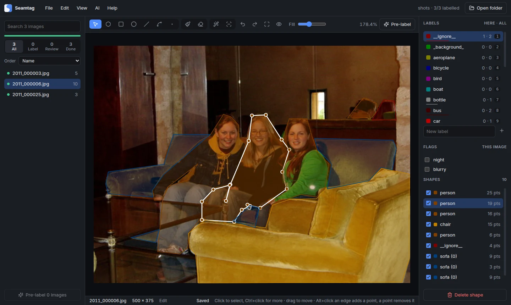
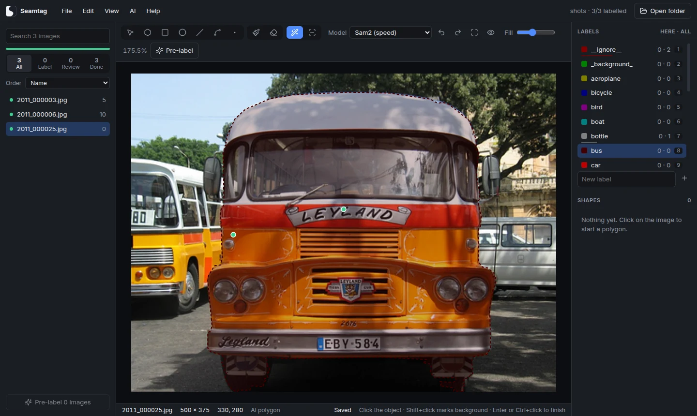
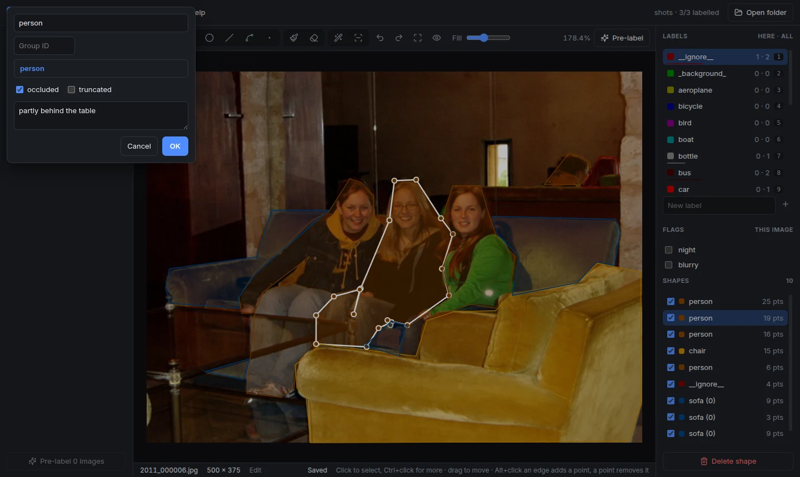

<p align="center">
  <picture>
    <source media="(prefers-color-scheme: dark)" srcset="docs/brand/seamline-logo-on-dark.svg">
    
  </picture>
</p>

<h1 align="center">Seamline Label</h1>

<p align="center"><b>Label images in LabelMe format, with labelme's tools, a brush and eraser, AI segmentation, and review of a model's proposals. For Windows, macOS and Linux.</b></p>

<p align="center">
  <a href="https://github.com/jakhon37/SeamlineLabel/actions/workflows/ci.yml"></a>
  <a href="LICENSE"></a>
</p>



Seamline Label is the labelling half of [Seamline](https://github.com/jakhon37/Seamline), on its own. It reads and writes the same JSON files as [labelme](https://github.com/wkentaro/labelme), takes the same command line and config keys, and offers the same tools, so a folder labelled in either opens in the other. Everything runs on your computer: images, labels and AI models never leave it.

## What it does

**labelme's tools.** Polygons, rectangles, circles, lines, line strips and points, drawn by labelme's rules: click the first point to close, Shift for a square, lines stop at the image edge. Edit labels with labelme's dialog (completion, flags per label pattern, group ID, description, and `--validatelabel exact`), tick image flags, hide or reorder shapes, copy and paste them between images, merge polygons, add and remove points (Alt+click, or `Ctrl+M` for several along an edge), keep the previous image's shapes, and adjust brightness and contrast. labelme 7's oriented rectangles and locked shapes open and save too.

**AI polygon and AI mask.** Click an object and SAM outlines it; Shift+click marks background. The models are the eight labelme 5 offers (EfficientSAM in two sizes, SAM and SAM2 in three), downloaded once from the addresses labelme uses and kept in the same cache, so a model labelme fetched is already here.



**Pre-label with your own model.** Point it at a segmentation model exported to ONNX, for example from Seamline, and it proposes shapes for every unlabelled image, each with a score. Proposals stay dashed until you accept them: `W` accepts, `S` rejects, `Tab` skips, and the list can put the least certain images first.

**Brush and eraser.** Paint a class, and shapes of that class you touch join it. Erase from one shape or everything under the stroke, splitting shapes or cutting holes.

**Big images.** Large and TIFF images open from a tile pyramid that libvips builds once, so only the tiles in view load: a 6050 × 12300 TIFF opens again in under a second, and zoom goes to 5000%.

**Labels that are hard to lose.** Saves go through one queue to a temporary file and then into place. A label file that can't be read is shown read-only and never written over, and closing the window saves first, or asks when saving isn't automatic.



## Install

Download the installer for your system from [Releases](https://github.com/jakhon37/SeamlineLabel/releases).

| System | File | Notes |
|---|---|---|
| Windows 10 and 11 | `Seamline-Label-…-win-x64.exe` | Not code-signed yet: on the SmartScreen warning, choose More info, then Run anyway. |
| macOS on Apple silicon | `Seamline-Label-…-mac-arm64.dmg` | Not notarised yet: right-click the app and choose Open the first time, or run `xattr -cr "/Applications/Seamline Label.app"`. |
| macOS on Intel | `Seamline-Label-…-mac-x64.dmg` | As above. |
| Linux | `Seamline-Label-…-linux-amd64.deb` | `sudo apt install ./Seamline-Label-*.deb` adds a `seamline-label` command, and on Ubuntu 24.04 and later the AppArmor profile Chromium's sandbox needs. |
| Linux, any distribution | `Seamline-Label-…-linux-x86_64.AppImage` | `chmod +x` it and run it. On Ubuntu the .deb is simpler: an AppImage can't add that profile, so from 24.04 it needs `--no-sandbox`, and it needs `sudo apt install libfuse2t64` (`libfuse2` on 22.04). |

To build it yourself you need Node 22:

```bash
git clone https://github.com/jakhon37/SeamlineLabel.git
cd SeamlineLabel
npm ci
npm run dev
```

`npm run dist` builds the installer for the system you're on, into `release/`.

## Use

Open a folder of images: labels are saved beside each image as `name.json`, in labelme's format. Images in subfolders are listed too. The command line is labelme's:

```bash
seamline-label images/ --labels labels.txt --flags night,blurry --labelflags '{person: [occluded]}' -O labels/
```

| Option | |
|---|---|
| `--labels LIST\|FILE` | Labels to offer, comma separated or one per line in a file |
| `--flags LIST\|FILE` | Flags for each image |
| `--labelflags YAML\|FILE` | Flags for shapes whose label matches a pattern |
| `--validatelabel exact` | Only allow listed labels |
| `-O`, `--output DIR\|FILE.json` | Save label files somewhere else |
| `--nodata`, `--autosave`, `--keep-prev`, `--nosortlabels`, `--epsilon N` | As in labelme |
| `--config FILE\|YAML` | A config file, such as your `~/.labelmerc`, or YAML overrides |

Settings live in `~/.seamline-labelrc`, which takes labelme's keys, so a `~/.labelmerc` can be copied in as it is. File → Open config file opens it. [docs/config.md](docs/config.md) lists every key, including the shortcuts.

### Keys

| Key | Action |
|---|---|
| `P` `R` `V` | Polygon, rectangle, edit (labelme's `Ctrl+Shift+V`, `Ctrl+Shift+B` and `Ctrl+Shift+C` work too) |
| `B` `E`, `[` `]` | Brush, eraser, smaller and larger |
| `1`-`9` | Pick a label, or relabel the selected shapes |
| `A` `D` | Previous and next image; with `Ctrl+Shift`, copy this image's shapes over |
| `W` `S` `Tab`, `Shift+W` | Accept, reject or skip an AI proposal; accept all here and move on |
| `Enter`, double-click | Finish a polygon, line strip or AI shape |
| `Alt`+click | Add a point on an edge, or remove one |
| `Ctrl+M`, `Ctrl+Shift+M` | Add several points along an edge; merge selected polygons |
| `Ctrl+Z`, `Ctrl+Shift+Z` | Undo (a point while drawing), redo |
| Wheel, `Space`+drag, `0` | Zoom, pan, fit |

Help → Keyboard shortcuts lists them all.

### Pre-labelling models

Any ONNX model that takes an image as `[1, 3, H, W]` and returns scores per class as `[1, C, H, W]`, with background as class 0, works. A JSON file beside it with the same name says how to use it; every key is optional:

```json
{ "classes": ["scratch", "dent"], "mean": [0.485, 0.456, 0.406], "std": [0.229, 0.224, 0.225], "tile": 1024 }
```

Without `classes`, the label list names the classes, in order. Images bigger than `tile` go through tile by tile, and each shape's score is the model's mean confidence inside it, useful for ranking rather than as a probability.

## Working with labelme

The point is that files go both ways, so it's tested from both sides:

- Saving a file that labelme 5 wrote gives back the same bytes, including Python's float format and key order.
- Every `.json` in labelme's examples and test data opens.
- In CI, labelme 7.9.1 and 5.8.1 load the files this app writes with each drawing tool and turn every shape into pixels with `shapes_to_label`, as labelme's export scripts do. AI mask shapes pass the same check with a downloaded model.
- On the test photo, AI masks are the same as osam's, pixel for pixel, for EfficientSAM and SAM2. That needed Pillow's bilinear resize ported exactly, which a test checks against Pillow.

labelme's export scripts in [examples/](examples) (to VOC or COCO) work on these files with `pip install labelme`.

## How it's built

An Electron app in TypeScript. The main process reads and writes files, builds tile pyramids with libvips (through sharp), and runs ONNX models with onnxruntime, so no Python is needed. The window is React, drawing on a canvas; the LabelMe format lives in one shared module, [`src/shared/labelfile.ts`](src/shared/labelfile.ts). Unit tests (Vitest) cover the format, config, geometry and the resize; end-to-end tests (Playwright) drive the real app on Windows, macOS and Linux, each launch with a home folder and profile of its own. Installers are built by electron-builder on each system.

## History

This repository continues [LabelMeV2](https://github.com/jakhon37/LabelMeV2), a fork of labelme that made big images load faster and added 5000% zoom, points along an edge, polygon merge and dark mode: those are its first 29 commits. The labeller of Seamline's desktop app joined with its own history in [`6204364`](https://github.com/jakhon37/SeamlineLabel/commit/6204364), so its files keep their commits, and replaced the Qt app in [`c2cc715`](https://github.com/jakhon37/SeamlineLabel/commit/c2cc715). Version 3.0 is the first on the new stack; [CHANGELOG.md](CHANGELOG.md) has the rest.

## License

GPL-3.0, as labelme. The AI models are downloaded from their authors' releases under their own licences: SAM, SAM2 and EfficientSAM are Apache-2.0.

Thanks to Kentaro Wada for [labelme](https://github.com/wkentaro/labelme) and [osam](https://github.com/wkentaro/osam).
